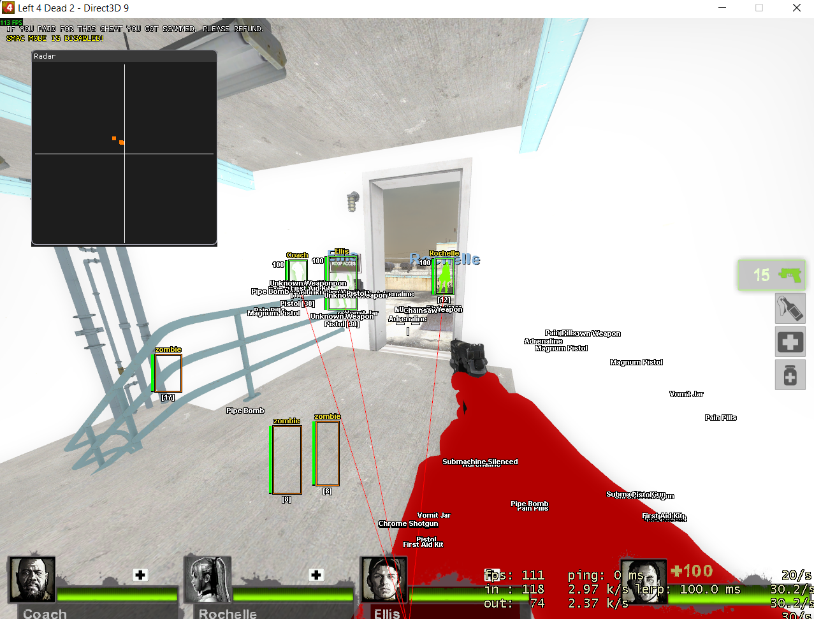
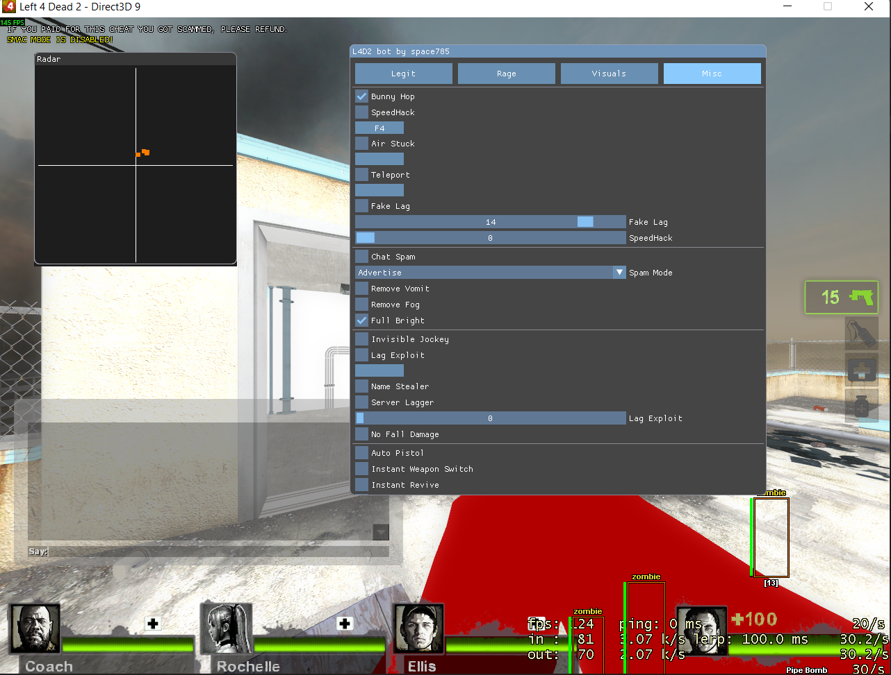

# Reverse-engineered L4D2 Internal by @space785

## Feature
### Legit

#### Aimbot Legit 
- No-Spread
- ~~No-Recoil~~ 
- FOV Circle
- Triggerbot
- ~~Auto Shove~~ 
- Rage

#### Aimbot Rage 
- Auto Shove
- No-Recoil
- No-Spread
- ~~Auto Melee~~ 
- Hack vs Hack 
- SMAC Mode (semi)* 

#### Visuals

- ESP
- World Weapons ESP
- Radar + names
- Thirdperson
- Player Chams / Hand Chams / XQZ Chams + colors
- FOV Changer
- Aspect Ratio
- No Visual Recoil
- Misc

- Bunny Hop
- SpeedHack
- ~~Air Stuck~~
- ~~Teleport~~
- Fake Lag
- Chat Spam
- Remove Vomit
- Remove Fog
- Full Bright
- ~~Invisible Jockey~~
- ~~Exploit~~
- Name Stealer
- ~~Server Lagger~~ 
- ~~No Fall Damage~~
- ~~Auto Pistol~~

#### Missing / partial in rebuild

- Rage SMAC-mode angle prediction *
- Post-Auto-Shove anti-aim movement *
- sub_10004190 movement normalization * — minor movement difference with anti-aim off
- Melee weapon-id-19 path (auto melee)

## Limitations

### BLOCKED (4)

1. Rage SMAC-mode angle prediction, `0x100064C9..0x100066B5`.
2. Post-Auto-Shove anti-aim movement, `0x100066C9..0x100067AA`.
3. Melee weapon-id-19 Rage path, `0x100067B7..0x10006A02`.
4. `sub_10004190` movement normalization when anti-aim is off.

These are off at default settings except the melee path, which affects melee
weapons only. Ledger rows `F025`, `F047`-`F049`.

### INFERRED names/types

17 ledger rows are INFERRED, including: `InitInterfaces` slot 1
(GetGlobalVars), `GetEntityRenderableModelId`, config loader/saver wiring and
keys, menu fixed size, `CGlobalVars` partial layout, `g_MenuState` partial
layout, `LocalWeaponHasClip` fallback, and the safety guards
`ReadPointer`/`IsBboxSane`/varargs text handling. All are flagged in source
with `// INFERRED`.

### Preserved quirks, bugs and undefined-behavior dependencies

- Triggerbot: Delay 0 never fires; Delay 1-15 yields threshold 0 and fires
  immediately; limb flag has no writer, so hitgroups 4-7 never match.
- Invisible Jockey: inverted `0.0 > distance` guard makes the write
  unreachable; ported as-is.
- Auto Pistol and Server Lagger flags are never read; UI/config-only.
- PaintTraverse speed text and the Monitor panel gates have no writers.
- Legit Auto Shove is geometrically broken; Teleport, Air Stuck and Legit
  No-Recoil are inert in the original.
- Legit LOS accepts `CBreakableSurface` by checking the candidate, not the
  hit entity.
- Radar's orphan mouse-drag block is intentionally not ported; EndScene
  overwrites those globals every frame.
- Menu owns keyboard/mouse while open; confirmed original behavior.

### Intentional deviations (failure paths only)

- `IsBboxSane` rejects non-finite/absurd box coordinates; the original can
  pass INT_MIN into text and crash.
- `ReadPointer` and interface/model/bone guards skip instead of walking
  null.
- `LocalWeaponHasClip` falls back to true if netprops cannot resolve.
- No-Spread skips on scan failure instead of calling/dereferencing null.
- No-Spread validates the seed address lies inside `client.dll`.
Successful paths match the target.

